# IslandHub

**Eine Dynamic Island für Windows 10 und 11.** Eine kleine schwarze Insel oben in der Mitte des Bildschirms zeigt, was gerade passiert – Musik, Nachrichten, Timer, Downloads, wer dein Mikrofon nutzt – und öffnet sich zu kleinen Seiten, wenn du mit der Maus darauf zeigst.

**[▶ Alle Animationen zum Ausprobieren – mit Reglern](https://Snipez5768.github.io/IslandHub/)** · **[⬇ Download](https://github.com/Snipez5768/IslandHub/releases/latest)**

---

## Was sie kann

| | |
|---|---|
| 🎵 **Musik** | Cover, Titel, Spulen, Weiter/Zurück aus jeder App (Spotify, YouTube im Browser …). Bei Spotify Warteschlange und eigene Lautstärke. |
| 📋 **Zwischenablage** | Verlauf mit Text, Links, Bildern und Dateien, Suche, Anheften. Stapel-Modus: mehrmals kopieren, jedes Strg+V fügt das nächste ein. |
| 📸 **Bildschirmfoto** | Bereich, Fenster, Bildschirm, GIF – mit Editor und Texterkennung (offline). |
| 🔔 **Mitteilungen** | Spiegelt Windows-Benachrichtigungen. Erst eine schmale Laufzeile, mit der Maus darauf die volle Karte. Codes aus Nachrichten mit einem Klick kopieren. |
| ⏱ **Timer · Wecker** | Räder wie beim iPhone, ein eingefräster Umschalter zwischen Dauer und Uhrzeit. |
| 🎙 **Live** | Wer gerade Mikrofon, Kamera oder Bildschirm nutzt – mit Stummschalten, Discord-Anruf und Stream. |
| ✳ **Agent** | Fortschritt von Claude Code direkt in der Insel. |
| 🎮 **Spiele** | Spiele und Programme mit einem Klick starten, Steam-Kachel mit allen Spielen per Rechtsklick. |
| ⬇ **Downloads** | Steam- und Browser-Downloads mit Fortschrittsring. |
| ✉️ **Bestätigungscodes** | Fragt eine Seite nach einem Code, holt die Insel deinen E-Mail-Tab nach vorne. |

## Animationen

Alles bewegt sich auf einer Feder wie bei iOS – nichts fliegt über den Bildschirm, alles passiert an der Insel.

<table>
<tr>
<td align="center"> Nachricht: Glocke → Laufzeile → Karte</td>
<td align="center"> Überspringen: Weiter → · ← Zurück</td>
</tr>
<tr>
<td align="center"> Timer | Wecker</td>
<td align="center"> Einstellungen › Animationen: jede Animation zum Abspielen</td>
</tr>
</table>

Geschwindigkeit, Dämpfung und mehr kannst du auf der **[Demo-Seite](https://Snipez5768.github.io/IslandHub/)** selbst einstellen.

## Installieren

1. Die neueste **`IslandHub.exe`** unter [Releases](https://github.com/Snipez5768/IslandHub/releases/latest) laden.
2. Starten – die Insel erscheint oben in der Mitte. Braucht die [.NET 8 Desktop Runtime](https://dotnet.microsoft.com/download/dotnet/8.0).
3. Neue Versionen meldet die Insel selbst und installiert sie mit einem Klick.

Selbst bauen: `cd IslandHub` und `dotnet run`.

## Datenschutz

Alles bleibt auf deinem PC (`%AppData%\IslandHub`). Ins Netz geht nur, was du selbst einrichtest – Wetter, Preisalarme, Spotify, Discord – und die Frage an GitHub, ob es eine neue Version gibt. Die Vorschauen in den Einstellungen und auf dieser Seite zeigen nur erfundene Beispiele.

---

IslandHub ist ein eigenes Projekt und nicht mit Apple verbunden. Die Symbole sind selbst gezeichnet.
