# PeakPill

**Eine Dynamic Island für Windows 10 und 11.** Eine kleine schwarze Insel oben in der Mitte des Bildschirms zeigt, was gerade passiert – Musik, Nachrichten, Timer, Downloads, wer dein Mikrofon nutzt – und öffnet sich zu kleinen Seiten, wenn du mit der Maus darauf zeigst.

## Verstecken und zurückholen

## Platz machen

### Adressleiste

### YouTube im Vollbild

## Animationen

### Nachricht

### Überspringen

### Neuer Song

### Timer | Wecker

### … hört zu

## Einstellungen

## Installieren

1. **`PeakPill-Setup.exe`** unter [Releases](https://github.com/Snipez5768/PeakPill/releases/latest) laden und starten.
2. **Installieren** klicken – ohne Administrator-Rechte, nur für dich. Fehlt die .NET 8 Desktop Runtime, holt der Installer sie von Microsoft (Windows fragt einmal).
3. Die Insel erscheint oben in der Mitte. Neue Versionen meldet sie selbst und installiert sie mit einem Klick.

Entfernen: *Einstellungen › Apps › Installierte Apps › PeakPill*. Ohne Installer geht auch die einzelne **`PeakPill.exe`** (braucht dann die [.NET 8 Desktop Runtime](https://dotnet.microsoft.com/download/dotnet/8.0)).

PeakPill hieß bis Version 1.2.0 **IslandHub** – Einstellungen und Autostart werden beim ersten Start übernommen.

Selbst bauen: `cd PeakPill` und `dotnet run` – App und Installer zusammen mit `.\build-installer.ps1`.

## Datenschutz

Alles bleibt auf deinem PC (`%AppData%\PeakPill`). Ins Netz geht nur, was du selbst einrichtest – Wetter, Preisalarme, Spotify, Discord – und die Frage an GitHub, ob es eine neue Version gibt. Die Vorschauen in den Einstellungen und auf dieser Seite zeigen nur erfundene Beispiele.

---

PeakPill ist ein eigenes Projekt und nicht mit Apple verbunden. Die Symbole sind selbst gezeichnet.
