# IslandHub

**Eine Dynamic Island für Windows 10 und 11.** Eine kleine schwarze Insel oben in der Mitte des Bildschirms zeigt, was gerade passiert – Musik, Nachrichten, Timer, Downloads, wer dein Mikrofon nutzt – und öffnet sich zu kleinen Seiten, wenn du mit der Maus darauf zeigst.

## Verstecken und zurückholen

## Platz machen

### Adressleiste

### YouTube im Vollbild

## Animationen

### Nachricht

### Überspringen

### Neuer Song

### Timer | Wecker

### … hört zu

## Einstellungen

## Installieren

1. Die neueste **`IslandHub.exe`** unter [Releases](https://github.com/Snipez5768/IslandHub/releases/latest) laden.
2. Starten – die Insel erscheint oben in der Mitte. Braucht die [.NET 8 Desktop Runtime](https://dotnet.microsoft.com/download/dotnet/8.0).
3. Neue Versionen meldet die Insel selbst und installiert sie mit einem Klick.

Selbst bauen: `cd IslandHub` und `dotnet run`.

## Datenschutz

Alles bleibt auf deinem PC (`%AppData%\IslandHub`). Ins Netz geht nur, was du selbst einrichtest – Wetter, Preisalarme, Spotify, Discord – und die Frage an GitHub, ob es eine neue Version gibt. Die Vorschauen in den Einstellungen und auf dieser Seite zeigen nur erfundene Beispiele.

---

IslandHub ist ein eigenes Projekt und nicht mit Apple verbunden. Die Symbole sind selbst gezeichnet.
